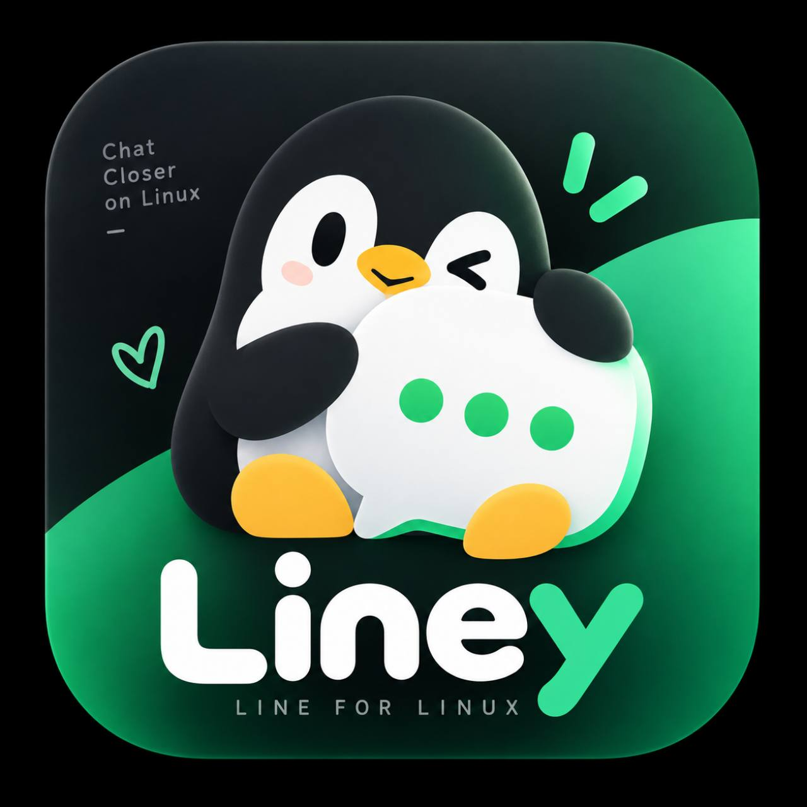

# Liney

<p align="center">
  
</p>

<p align="center"><strong>LINE for Linux.</strong><br>Chat closer on Linux.</p>

Liney is an independent Linux desktop client for LINE. The UI is built with
React + Tauri (WebView), the protocol engine is a standalone TypeScript/Bun
sidecar, and it uses SQLite + LINEJS. The application connects to LINE
directly from the user's device; Liney does not operate a relay server or
collect messages through a central backend.

Liney is developed and maintained under **Cytech Team Development**.

> Liney is unofficial software. It is not affiliated with, authorized by,
> endorsed by, sponsored by, or officially associated with LY Corporation or
> the official LINE application. Its use may not comply with LINE's Terms of
> Service (TOS); read the warning shown before login and use it at your own
> risk.

## Why Liney exists

LINE is part of everyday communication for many people in Thailand and
elsewhere: work, meetings, school, family, friends, communities, customer
support, and business communication all commonly happen there.

For a Linux user, "just use another messenger" is often not a practical
answer. Liney exists to make access to the people and communities that depend
on LINE less dependent on Windows, Wine, virtual machines, or fragile desktop
workarounds.

The project was also inspired by the idea behind Line-GTK: Linux users should
be able to have a client that feels like it belongs on Linux. Liney is an
independent project and is not affiliated with the Line-GTK maintainers.

There is a small personal motivation too: the author does not particularly
like Windows, and has had enough experiences of it breaking a computer. A
Linux-native client seemed like a better use of that frustration.

## What Liney is

Liney is an interactive desktop client. It uses LINEJS as the protocol and
communication layer, then adds a native Linux UI, local persistence, secure
credential handling, synchronization, media workers, notifications, and a
versioned engine RPC boundary.

LINEJS describes itself as a JavaScript library for creating LINE SelfBots.
Liney uses that library as the backend of an interactive client. Liney is not
intended to be a spam tool, mass-messaging system, account farm, or general
automation framework.

```text
Liney UI (React + Tauri WebView)
        |
        | versioned JSONL IPC
        v
Liney engine (Bun + TypeScript)
        |
        | LINEJS adapter
        v
LINE services
```

## Current implementation

- QR login, email/password login, and session restore through the local engine.
- Email/password login includes LINE's device-verification PIN flow when the
  service requests one; Liney clears the password from the UI immediately and
  never stores it in localStorage, the session file, or the credential wallet.
- Secret Service or KWallet storage for persistent credentials.
- Session-only fallback when a wallet is unavailable; refresh credentials are
  not written to plaintext files in that mode.
- SQLite message history with WAL mode, foreign keys, indexes, deduplication,
  per-room sync state, and explicit local history clearing.
- Full synchronization of profile data, friends, Talk, OpenChat, unread,
  pinned/favorite state, and recent history where the current LINEJS path
  exposes the data.
- Versioned JSONL RPC with request IDs, structured errors, retry metadata, and
  engine events.
- Optimistic message sending through an outbox with queued, sending, sent,
  failed, and unknown states.
- Timeout reconciliation before retrying a message, so a request that may
  already have reached LINE is checked before sending again.
- Worker-based media upload/download paths, bounded file handling, temporary
  opaque media references, progress, cancellation, and a disk preview cache.
- Native tray, close-to-tray, desktop notification, reconnect, and startup
  integration on supported Linux desktops.
- A real outgoing 1:1 audio call path uses LINEJS PLANET, Opus, and PipeWire
  when the local audio session is available. Incoming-call notifications are
  shown, but accepting an incoming call is not advertised until LINEJS
  exposes a stable PLANET answer flow. Video, group calls, and LiveTalk are
  not advertised.

The application reports capabilities enabled by the running engine and keeps
the `liveValidated` flag separate for real two-account verification. A
feature that is not implemented is shown as disabled rather than as a mock
interaction.

## Security and local data

Liney has no central message relay. Authentication and message data stay on
the local device unless LINE itself or a user-selected external service is
involved.

The default data directory is:

```text
~/.local/share/liney/
```

The engine creates the directory with mode `0700` and private files with mode
`0600`, uses atomic replacement for JSON state, and starts with a restrictive
umask. The database and session state do not intentionally contain refresh
credentials when the wallet path is available. A wallet-unavailable login is
session-only and does not persist the token to disk.

The following legacy files are migrated or quarantined when found:

```text
auth.json
linejs-session.json
```

`history.clear` is separate from logout. Clearing local history removes local
messages, outbox records, and media cache; it does not delete messages from
LINE. Logout clears local session and wallet credentials but is not a history
wipe.

For isolated development or testing, set `LINEY_DATA_DIR` to a private
directory. Never put `auth.json`, `linejs-session.json`, access tokens, or
refresh tokens into source control, bug reports, screenshots, or release
archives.

## Development requirements

- Linux with WebKitGTK, GStreamer, and PipeWire runtime libraries.
- Bun 1.4 or newer.
- Rust 1.77.2 or newer.
- A working Secret Service or KWallet integration for persistent credentials.
- `secret-tool` is useful for checking the wallet from a terminal.

Install dependencies and start the desktop app (React + Tauri WebView):

```sh
bun install
bun run doctor    # verify WebKitGTK 4.1 / Linux desktop dependencies
bun run dev       # static WebView; ไม่เปิด localhost/web server
bun run dev:web   # optional Vite HMR development server
```

Build a release bundle:

```sh
bun run build
```

The internals stay cleanly separated: `src/` (React UI) talks to the
`liney-engine` sidecar over versioned JSONL, and the engine owns all LINEJS,
SQLite, sync, and media logic.

## Public web preview

The Vite build also contains a static product-preview site for
`liney.namnarak.in.th`:

```text
/        product overview
/login   login-flow illustration (demo only)
/chat    interactive mock chat UI (demo data only)
```

These pages do not log in to LINE, send credentials, or connect to the Liney
engine. They are intended for public product communication only. Deploy the
`dist/` directory to Cloudflare Pages with `bun run web:build` (or
`npm run web:build`), and keep the included `public/_redirects` file so direct
loads of `/login` and `/chat` fall back to the SPA entry point.

## Engine RPC

The engine communicates over JSON Lines. Every request and response uses
protocol version `1` and a caller-owned request ID.

```json
{"id":"req-1","version":1,"method":"message.list","params":{"chatId":"..."}}
{"id":"req-1","version":1,"ok":true,"result":{"messages":[]}}
{"type":"sync.progress","version":1,"payload":{"chatId":"...","done":3,"total":12}}
```

Core methods include:

```text
auth.qr.start       auth.password.start  auth.restore       auth.logout
sync.start          sync.cancel       sync.status       chat.list
message.list        message.send      message.retry
media.preview       media.send        chat.markRead
call.start          call.accept       call.reject
call.end            call.setMuted      call.status
call.devices        call.setOutput
```

## Checks

Run the automated checks from the project root:

```sh
bun test
bun run lint
bun run build
```

The repository includes unit tests for storage migration, SQLite behavior,
message normalization, media handling, outbox reconciliation, call gating,
and the engine RPC contract.

## Build and release

The release workflow builds the engine sidecar, React + Tauri (WebView) app,
`.deb`, and AppImage with `bun run build` for x86_64 and aarch64 runners. It
verifies the WebKit build and AppImage runtime, then uploads the packages,
binaries, and hashes.

Local helpers:

```sh
bun run dev        # static Tauri WebView; ไม่แย่ง port
bun run dev:web    # optional Vite + Tauri HMR
bun run build          # release .deb + AppImage (also builds the sidecar)
bun run build:deb      # Debian package only
bun run build:appimage # AppImage only
bun run web:build      # frontend only
bun run engine:build   # compile and stage the engine sidecar
```

Release bundles must never contain credentials or a user's session.

## Public website / GitHub Pages

The public-facing landing page and project documents live in [`website/`](website/):

- landing page
- Download / FAQ
- Safety Notice about the unofficial client and LINE TOS risk
- Privacy Notice
- Liney Terms of Use draft
- The Liney License 1.0 summary
- GitHub Pages 404 page

The [`website` workflow](.github/workflows/pages.yml) publishes the directory
through GitHub Pages when changes reach `main` or `master`. In the repository's
Settings → Pages, choose **GitHub Actions** as the source. For a normal
`OWNER.github.io/REPOSITORY` URL, the site derives the GitHub repository and
Releases links automatically; set `repositoryUrl` and `releaseUrl` in
[`website/site-config.js`](website/site-config.js) when using a custom domain.

The Terms and Privacy pages are publication drafts, not legal advice. Review
them for the intended jurisdiction and distribution model before treating them
as binding legal documents.

## Known boundaries

Liney relies on an unofficial implementation of LINE's protocols. It may
break when LINE changes its services, and its use may violate LINE's Terms of
Service or other applicable policies. There is no guarantee that an account
will remain unrestricted, that login will continue to work, or that every
feature will match the official client.

Users are responsible for deciding whether to use Liney and for the accounts
they use with it. Do not use an account that you cannot afford to lose. The
project does not encourage spam, abuse, bypassing security controls, or
interference with LINE services.

The outgoing call path is deliberately limited to audio 1:1. It requires a
reachable PipeWire session and still needs a real two-account, two-way audio
test on the target system before a release can be labelled live-validated.
The UI never presents video or group-call controls, and it does not pretend
that the current LINEJS incoming notification hook can answer a call.

## Relationship with LINE and future cooperation

Liney is intended to remain visually distinguishable from official LINE
branding. The penguin mascot and original Liney artwork are project branding;
LINE names, marks, characters, and official artwork belong to their respective
owners.

If LINE, LY Corporation, or an authorized representative has concerns about
branding, protocol use, security, distribution, features, official notices,
advertising, or legal matters, please contact:

**namnarak@namnarak.in.th**

Cytech Team Development is willing to discuss reasonable changes, a safer
implementation, migration to an official API or SDK, authorized notices or
advertising, cooperation, or a request to modify, restrict, or discontinue
distribution. See the compliance section in [The Liney License 1.0](LICENSE).

## License

Liney is currently distributed under **The Liney License 1.0 (TLL-1.0)**. It is
a custom source-available license with copyleft-like redistribution terms and
a compliance/cooperation mechanism. It is not GPL-3.0 and should not be
described as OSI-approved Open Source.

Third-party dependencies and bundled components remain under their own
licenses. Read the relevant notices before redistributing a build.

See [LICENSE](LICENSE) for the complete terms.

## Distribution

Validated Linux release artifacts are generated with:

```sh
bun run release:local
```

This runs the dependency doctor, unit tests, lint, and Tauri packaging, then writes
versioned AppImage, Debian, RPM, portable tarball, and SHA-256 checksum files to
`release/`. The portable tarball includes `install-user.sh` for a per-user install.

Tags matching the application version (for example `v0.1.0`) run the same release
gate in GitHub Actions on x86_64 and aarch64 and attach the verified artifacts to
the GitHub Release automatically.
