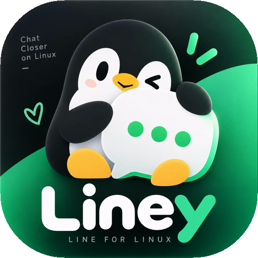

<div align="center">



<h1>Liney</h1>

**LINE for Linux.**
*Chat closer on Linux.*

<p>
  <a href="#development-requirements"></a>
  <a href="#what-liney-is"></a>
  <a href="#engine-rpc"></a>
</p>

<p>
  <a href="#current-implementation"></a>
  <a href="#license"></a>
  <a href="#license"></a>
  <a href="#build-and-release"></a>
</p>

<a href="https://liney.namnarak.in.th">Website</a> ·
<a href="https://github.com/Cytech-Team/Liney/releases">Downloads</a> ·
<a href="#current-implementation">Features</a> ·
<a href="#security-and-local-data">Privacy &amp; Security</a> ·
<a href="#development-requirements">Development</a> ·
<a href="#star-history">Star History</a>

</div>

<!-- CYTECH_README_REFRESH:START -->
<p align="center"><sub>Independent LINE client for Linux</sub></p>

<p align="center"><a href="#why-liney-exists">Why Liney exists</a> &nbsp;·&nbsp; <a href="#what-liney-is">What Liney is</a> &nbsp;·&nbsp; <a href="#current-implementation">Current implementation</a> &nbsp;·&nbsp; <a href="#security-and-local-data">Security and local data</a> &nbsp;·&nbsp; <a href="https://github.com/Cytech-Team/Liney/issues">Issues</a> &nbsp;·&nbsp; <a href="https://github.com/Cytech-Team/Liney/releases">Releases</a></p>

<!-- CYTECH_README_REFRESH:END -->

---

Liney is an independent Linux desktop client for LINE. The UI is built with
React + Tauri (WebView), the protocol engine is a standalone TypeScript/Bun
sidecar, and it uses SQLite + LINEJS. The application connects to LINE
directly from the user's device; Liney does not operate a relay server or
collect messages through a central backend.

Liney is developed and maintained under **Cytech Team Development**.

> Liney is unofficial software. It is not affiliated with, authorized by,
> endorsed by, sponsored by, or officially associated with LY Corporation or
> the official LINE application. Its use may not comply with LINE's Terms of
> Service (TOS); read the warning shown before login and use it at your own
> risk.

## Why Liney exists

LINE is part of everyday communication for many people in Thailand and
elsewhere: work, meetings, school, family, friends, communities, customer
support, and business communication all commonly happen there.

For a Linux user, "just use another messenger" is often not a practical
answer. Liney exists to make access to the people and communities that depend
on LINE less dependent on Windows, Wine, virtual machines, or fragile desktop
workarounds.

The project was also inspired by the idea behind Line-GTK: Linux users should
be able to have a client that feels like it belongs on Linux. Liney is an
independent project and is not affiliated with the Line-GTK maintainers.

There is a small personal motivation too: the author does not particularly
like Windows, and has had enough experiences of it breaking a computer. A
Linux-native client seemed like a better use of that frustration.

## What Liney is

Liney is an interactive desktop client. It uses LINEJS as the protocol and
communication layer, then adds a native Linux UI, local persistence, secure
credential handling, synchronization, media workers, notifications, and a
versioned engine RPC boundary.

LINEJS describes itself as a JavaScript library for creating LINE SelfBots.
Liney uses that library as the backend of an interactive client. Liney is not
intended to be a spam tool, mass-messaging system, account farm, or general
automation framework.

```text
Liney UI (React + Tauri WebView)
        |
        | versioned JSONL IPC
        v
Liney engine (Bun + TypeScript)
        |
        | LINEJS adapter
        v
LINE services
```

## Current implementation

- QR login, email/password login, and session restore through the local engine.
- Email/password login includes LINE's device-verification PIN flow when the
  service requests one; Liney clears the password from the UI immediately and
  never stores it in localStorage, the session file, or the credential wallet.
- Secret Service or KWallet storage for persistent credentials.
- Session-only fallback when a wallet is unavailable; refresh credentials are
  not written to plaintext files in that mode.
- SQLite message history with WAL mode, foreign keys, indexes, deduplication,
  per-room sync state, and explicit local history clearing.
- Full synchronization of profile data, friends, Talk, OpenChat, unread,
  pinned/favorite state, and recent history where the current LINEJS path
  exposes the data.
- Versioned JSONL RPC with request IDs, structured errors, retry metadata, and
  engine events.
- Optimistic message sending through an outbox with queued, sending, sent,
  failed, and unknown states.
- Timeout reconciliation before retrying a message, so a request that may
  already have reached LINE is checked before sending again.
- Worker-based media upload/download paths, bounded file handling, temporary
  opaque media references, progress, cancellation, and a disk preview cache.
- Native tray, close-to-tray, desktop notification, reconnect, and startup
  integration on supported Linux desktops.
- 1:1 calls use LINEJS PLANET and Opus with Liney's native audio helper.
  Incoming answering and video transport remain experimental, while camera,
  microphone, speaker, and screen-share availability are isolated capabilities:
  missing hardware disables only that control and does not block joining a call.

The application reports capabilities enabled by the running engine and keeps
the `liveValidated` flag separate for real two-account verification. A
feature that is not implemented is shown as disabled rather than as a mock
interaction.

## Security and local data

Liney has no central message relay. Authentication and message data stay on
the local device unless LINE itself or a user-selected external service is
involved.

The default data directory is:

```text
~/.local/share/liney/
```

The engine creates the directory with mode `0700` and private files with mode
`0600`, uses atomic replacement for JSON state, and starts with a restrictive
umask. The database and session state do not intentionally contain refresh
credentials when the wallet path is available. A wallet-unavailable login is
session-only and does not persist the token to disk.

The following legacy files are migrated or quarantined when found:

```text
auth.json
linejs-session.json
```

`history.clear` is separate from logout. Clearing local history removes local
messages, outbox records, and media cache; it does not delete messages from
LINE. Logout clears local session and wallet credentials but is not a history
wipe.

For isolated development or testing, set `LINEY_DATA_DIR` to a private
directory. Never put `auth.json`, `linejs-session.json`, access tokens, or
refresh tokens into source control, bug reports, screenshots, or release
archives.

## Development requirements

Building Liney from source requires Bun 1.4+, Rust 1.85+, WebKitGTK 4.1
development files for the Tauri/Wry UI, and the development libraries used to
compile the optional native capability sidecars. These are source-build
requirements, not a requirement that every runtime feature be present.

Liney follows a **standalone-first, system-aware** runtime model:

- `liney-media` owns camera capture/encoding and system keyring integration.
- `liney-audio` owns microphone, speaker, resampling, and call tones.
- `liney-screen` owns XDG Desktop Portal/PipeWire screen capture.
- `liney-screen-wayland` owns direct Wayland capture through
  `ext-image-copy-capture-v1`, with `wlr-screencopy-v1` fallback.
- `liney-screen-x11` owns native X11 capture without PipeWire: XShm fast
  capture with core GetImage fallback, RandR/Xinerama monitor discovery,
  XComposite mapped-window capture, XDamage dirty-region refresh, XFixes cursor
  compositing, and desktop/monitor/window/region targets.
- `liney-engine` owns LINEJS, call transport, storage, sync, and capability
  fallback behavior.

The main application does not require GStreamer, FFmpeg, `pw-cat`, `grim`,
`slurp`, or `secret-tool`. Audio follows the user's system-default input/output.
Camera uses native V4L2 plus bundled OpenH264. Screen sharing is selected by
runtime capability rather than desktop name: Portal/PipeWire is preferred;
Wayland can fall back to `ext-image-copy-capture-v1` and then
`wlr-screencopy-v1`; a real X11 session can fall back to native X11 capture.
The X11 backend prefers XShm and falls back to core GetImage if XShm is
unavailable. Optional XDamage, XComposite, XFixes, RandR, and Xinerama support
improves efficiency or target selection without becoming launch requirements.
Mapped X11 windows can be shared directly; minimized/unmapped windows are not
promised because X11 does not guarantee backing pixels for them. Liney
deliberately does not use an XWayland root window as a fake Wayland desktop
capture. If one capability cannot run, only that capability is disabled; the
rest of Liney continues to work.

Start the desktop app (React + Tauri WebView):

```sh
bun install
bun run doctor    # source-build checks + non-failing runtime capability report
bun run dev       # static WebView; ไม่เปิด localhost/web server
bun run dev:web   # optional Vite HMR development server
```

Build a release bundle:

```sh
bun run build
```

The internals stay cleanly separated: `src/` (React UI) talks to the
`liney-engine` sidecar over versioned JSONL, and the engine owns all LINEJS,
SQLite, sync, and media logic.

## Web experience vs. public website

The main public product website is the static site under [website/](website/),
deployed through Cloudflare Pages at https://liney.namnarak.in.th.
It includes product information, downloads and the current development status.

The React / Vite frontend under src/ is the shared desktop UI frontend; its
web-preview and browser-runtime paths are separate from the product website.
A public Web App route is experimental and must not be described as having the
same capabilities, session model or privacy boundary as the local Desktop build.
When testing preview/demo views, do not treat demo content as a real LINE login.

For the public website build and deploy instructions, see
[website/README.md](website/README.md).

## Engine RPC

The engine communicates over JSON Lines. Every request and response uses
protocol version `1` and a caller-owned request ID.

```json
{"id":"req-1","version":1,"method":"message.list","params":{"chatId":"..."}}
{"id":"req-1","version":1,"ok":true,"result":{"messages":[]}}
{"type":"sync.progress","version":1,"payload":{"chatId":"...","done":3,"total":12}}
```

Core methods include:

```text
auth.qr.start       auth.password.start  auth.restore       auth.logout
sync.start          sync.cancel       sync.status       chat.list
message.list        message.send      message.retry
media.preview       media.send        chat.markRead
call.start          call.accept       call.reject
call.end            call.setMuted      call.status
call.devices        call.setOutput
```

## Checks

Run the automated checks from the project root:

```sh
bun test
bun run lint
bun run build
```

The repository includes unit tests for storage migration, SQLite behavior,
message normalization, media handling, outbox reconciliation, call gating,
and the engine RPC contract.

## Build and release

The release workflow builds the engine sidecar and React + Tauri desktop app,
then packages AppImage, DEB, RPM and portable TAR.GZ for x86_64 and aarch64.
It also builds a Flatpak bundle for x86_64. Artifacts and SHA-256 checksums are
attached to a published GitHub Release when its version tag passes all jobs.
An uploaded .flatpak bundle does not mean the project is listed on Flathub;
PKGBUILD files in this repository are not AUR listings.

Local helpers:

```sh
bun run dev        # static Tauri WebView; ไม่แย่ง port
bun run dev:web    # optional Vite + Tauri HMR
bun run build          # release .deb + AppImage (also builds the sidecar)
bun run build:deb      # Debian package only
bun run build:appimage # AppImage only
bun run web:build      # frontend only
bun run engine:build   # compile and stage the engine sidecar
```

Release bundles must never contain credentials or a user's session.

## Public website / Cloudflare Pages

The public landing page, current feature status and download guide are in
[website/](website/). The published site is
[Liney Website](https://liney.namnarak.in.th), linking directly to
this repository's **actual published GitHub Release assets**.

- [Download and installation](https://liney.namnarak.in.th/download.html)
  presents AppImage, DEB, RPM, Flatpak and TAR.GZ per architecture.
- [Safety Notice](website/notice.html), [Privacy](website/privacy.html),
  [Terms](website/terms.html) and [License](website/license.html).
- The site uses the public GitHub releases/latest API to find uploaded files,
  never constructing a download link for missing formats.
- Windows/macOS ports and Liney Lite are *ideas under consideration*, not
  released editions or promised features.

Cloudflare Pages builds production on the master branch using
`node website/build.mjs` (from the repository root) and serves `website/dist`.
The build fingerprints stylesheet and JavaScript assets to prevent HTML/CSS
version skew from Cloudflare or browser caches. See [website/README.md](website/README.md).
The website is informational, not the LINE Desktop protocol engine, and the
public Web App is a separate experimental route. Never enter LINE credentials
on a mirror or untrusted download page.

The Terms and Privacy pages are project drafts, not legal advice. Review them
for the applicable jurisdiction before treating them as binding legal documents.

## Known boundaries

Liney relies on an unofficial implementation of LINE's protocols. It may
break when LINE changes its services, and its use may violate LINE's Terms of
Service or other applicable policies. There is no guarantee that an account
will remain unrestricted, that login will continue to work, or that every
feature will match the official client.

Users are responsible for deciding whether to use Liney and for the accounts
they use with it. Do not use an account that you cannot afford to lose. The
project does not encourage spam, abuse, bypassing security controls, or
interference with LINE services.

Call support still depends on an unofficial LINE protocol implementation and
must be live-validated with real accounts after transport changes. Audio,
incoming answering, and video negotiation are kept separate from local hardware
capabilities: no camera means no local camera feed, no microphone means silence
from the local side, no speaker means no local playback, and an unavailable
screen-capture environment disables only screen sharing. Group calls and
LiveTalk are not advertised.

## Relationship with LINE and future cooperation

Liney is intended to remain visually distinguishable from official LINE
branding. The penguin mascot and original Liney artwork are project branding;
LINE names, marks, characters, and official artwork belong to their respective
owners.

If LINE, LY Corporation, or an authorized representative has concerns about
branding, protocol use, security, distribution, features, official notices,
advertising, or legal matters, please contact:

**namnarak@namnarak.in.th**

Cytech Team Development is willing to discuss reasonable changes, a safer
implementation, migration to an official API or SDK, authorized notices or
advertising, cooperation, or a request to modify, restrict, or discontinue
distribution. See [LICENSE](LICENSE) for Liney's source-code license. It does
not grant rights to LINE/LY Corporation's marks, content, or services, and it
does not replace the terms that apply to LINE services.

## License

Liney's original source code is licensed under the **MIT License**; see
[LICENSE](LICENSE). You may use, modify, and redistribute that code under the
license terms.

MIT covers only copyright rights in Liney code granted by its copyright
holders. It does not grant rights to LINE/LY Corporation's trademarks, logos,
content, or services, and it does not replace terms or policies that apply to
using LINE services. Liney is an independent, unofficial client. LINE may
separately enforce its rights or terms against particular users or
distributions; the effect depends on the specific facts and applicable law.
MIT provides no immunity from those rights.

Third-party dependencies and bundled components remain under their own
licenses. Read the relevant notices before redistributing a build.

## Distribution

Validated Linux release artifacts are generated with:

```sh
bun run release:local
```

This runs the source-build/capability doctor, unit tests, lint, and Tauri packaging, then writes
versioned AppImage, Debian, RPM, portable tarball, and SHA-256 checksum files to
`release/`. The portable tarball includes `install-user.sh` for a per-user install.

Tags matching the application version (for example `v0.1.3`) run the same release
gate in GitHub Actions on x86_64 and aarch64 and attach the verified artifacts to
the GitHub Release automatically.

## Star History

Follow Liney's public GitHub star growth on [Star History](https://star-history.dera.page/Cytech-Team/Liney).
